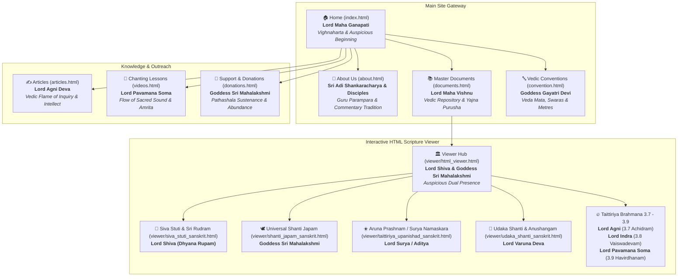

# VedaVMS Sacred Deities Visual Web Map & Directory

A sacred, iconography-guided site directory for the VedaVMS digital Vedic repository. Each Vedic deity presides over and anchors a core section of the knowledge base.

---

## 1. Visual Web Map (Mermaid Architecture)



---

## 2. Sacred Art Carousel

All 11 sacred deity paintings adhere to the classical temple fresco style with warm mineral pigments and fine calligraphic outlines:

````carousel

<!-- slide -->

<!-- slide -->

<!-- slide -->

<!-- slide -->

<!-- slide -->

<!-- slide -->

<!-- slide -->

<!-- slide -->

<!-- slide -->

<!-- slide -->

````

---

## 3. Web Map Directory & Page Navigation

### Gateway I: Main Site Core
| Deity Presiding | Local Page Link | Vedic Significance |
| :--- | :--- | :--- |
| **Lord Maha Ganapati** | [mockup/index.html](file:///c:/Users/sekha/OneDrive/Documents/GitHub/vedavms/mockup/index.html) | Auspicious portal invocation (*Om Shri Mahaganapathaye Namaha*), remover of obstacles. |
| **Sri Adi Shankaracharya & Disciples** | [mockup/about.html](file:///c:/Users/sekha/OneDrive/Documents/GitHub/vedavms/mockup/about.html) | Guru Parampara lineage, upholding authentic Advaita Vedic tradition. |
| **Lord Maha Vishnu** | [mockup/documents.html](file:///c:/Users/sekha/OneDrive/Documents/GitHub/vedavms/mockup/documents.html) | *Yajño vai Viṣṇuḥ* — cosmic preserver guarding the 972+ master Vedic texts and PDFs. |
| **Goddess Gayatri Devi** | [mockup/convention.html](file:///c:/Users/sekha/OneDrive/Documents/GitHub/vedavms/mockup/convention.html) | *Veda Mātā* — Mother of Vedic wisdom, presiding over swaras, accents, and pronunciation. |

### Gateway II: Knowledge & Community
| Deity Presiding | Local Page Link | Vedic Significance |
| :--- | :--- | :--- |
| **Lord Agni Deva** | [mockup/articles.html](file:///c:/Users/sekha/OneDrive/Documents/GitHub/vedavms/mockup/articles.html) | *Purohitam Yajnasa* — the celestial flame illuminating research, articles, and commentaries. |
| **Lord Pavamana Soma** | [mockup/videos.html](file:///c:/Users/sekha/OneDrive/Documents/GitHub/vedavms/mockup/videos.html) | Flowing amrita of sacred sound, presiding over multimedia and oral chanting lessons. |
| **Goddess Sri Mahalakshmi** | [mockup/donations.html](file:///c:/Users/sekha/OneDrive/Documents/GitHub/vedavms/mockup/donations.html) | Divine auspiciousness and sustenance supporting traditional Veda Pathashalas. |

### Gateway III: Interactive Scripture Sanctuary (HTML Viewer)
| Deity Presiding | Local Page Link | Vedic Hymn / Context |
| :--- | :--- | :--- |
| **Lord Shiva & Goddess Mahalakshmi** | [mockup/viewer/html_viewer.html](file:///c:/Users/sekha/OneDrive/Documents/GitHub/vedavms/mockup/viewer/html_viewer.html) | Dual Hero welcoming seekers to the interactive reader. |
| **Lord Shiva** *(Dhyāna Rūpam)* | [mockup/viewer/siva_stuti_sanskrit.html](file:///c:/Users/sekha/OneDrive/Documents/GitHub/vedavms/mockup/viewer/siva_stuti_sanskrit.html) | Siva Stuti, Sri Rudram (Namakam), and Chamakam. |
| **Goddess Sri Mahalakshmi** | [mockup/viewer/shanti_japam_sanskrit.html](file:///c:/Users/sekha/OneDrive/Documents/GitHub/vedavms/mockup/viewer/shanti_japam_sanskrit.html) | Universal Shanti Mantras and peace prayers. |
| **Lord Surya / Aditya** | [mockup/viewer/taittiriya_upanishad_sanskrit.html](file:///c:/Users/sekha/OneDrive/Documents/GitHub/vedavms/mockup/viewer/taittiriya_upanishad_sanskrit.html) | Taittiriya Aranyakam Prashna 1 (**Aruna Prashnam / Surya Namaskara Mantras**). |
| **Lord Varuna Deva** | [mockup/viewer/udaka_shanti_sanskrit.html](file:///c:/Users/sekha/OneDrive/Documents/GitHub/vedavms/mockup/viewer/udaka_shanti_sanskrit.html) | Udaka Shanti ritual water sanctification hymns. |
| **Lord Varuna Deva** | [mockup/viewer/udaka_shanti_anushangam_sanskrit.html](file:///c:/Users/sekha/OneDrive/Documents/GitHub/vedavms/mockup/viewer/udaka_shanti_anushangam_sanskrit.html) | Udaka Shanti Anushangam supplementary chants. |
| **Lord Agni Deva** | [mockup/viewer/tb_3_7_achidram_sanskrit.html](file:///c:/Users/sekha/OneDrive/Documents/GitHub/vedavms/mockup/viewer/tb_3_7_achidram_sanskrit.html) | Taittiriya Brahmana 3.7 Achidram (Sacrificial integrity). |
| **Lord Indra Deva** | [mockup/viewer/tb_3_8_aswamedham_vaiswadevam_sanskrit.html](file:///c:/Users/sekha/OneDrive/Documents/GitHub/vedavms/mockup/viewer/tb_3_8_aswamedham_vaiswadevam_sanskrit.html) | TB 3.8 Aswamedham Vaiswadevam (Cosmic sovereignty). |
| **Lord Pavamana Soma** | [mockup/viewer/tb_3_9_aswamedham_havirdhanam_sanskrit.html](file:///c:/Users/sekha/OneDrive/Documents/GitHub/vedavms/mockup/viewer/tb_3_9_aswamedham_havirdhanam_sanskrit.html) | TB 3.9 Aswamedham Havirdhanam (Celestial oblations). |

---

## 4. Physical Asset Integrity

All illustrations are located at:
- Master repository: [`assets/images/devatas/`](file:///c:/Users/sekha/OneDrive/Documents/GitHub/vedavms/assets/images/devatas/)
- Mockup preview: [`mockup/assets/images/devatas/`](file:///c:/Users/sekha/OneDrive/Documents/GitHub/vedavms/mockup/assets/images/devatas/)
- Production build: [`build/assets/images/devatas/`](file:///c:/Users/sekha/OneDrive/Documents/GitHub/vedavms/build/assets/images/devatas/)
